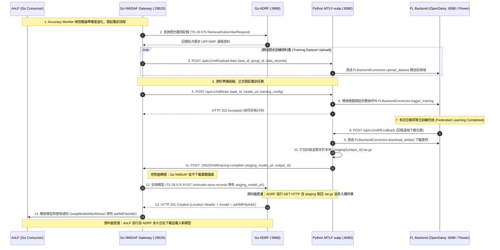

# NWDAF 架構解耦與 ADRF 同步設計文檔 (Refactor NWDAF and ADRF Sync)

本設計文檔詳細記錄了在將 3GPP NWDAF (Network Data Analytics Function) 中原先單體化的 MTLF (Model Training Logical Function) 拆分為獨立 Python 微服務 (`MTLF-subp`)，並與 ADRF (`TS 29.575`) 完成 Schema 同步及聯邦學習（FL）通用後端解耦的全部修改細節與架構演進紀錄。

---

## 1. 架構指導原則與設計核心

### 1.1 3GPP SBI 控制面與資料面嚴格分離 (Go Gateway Zero-Download)
- **Go NWDAF 為對外 3GPP SBI 的唯一通訊樞紐**：所有 3GPP 外部網元（如 ADRF、AnLF、SMF）間的服務溝通（`TS 29.575` / `TS 29.520`）嚴格遵照要求，僅能透過 Go 語言編寫的 NWDAF Gateway 進行。
- **資料面與控制面徹底分離**：Go NWDAF (`internal/mtlf`) 在模型重訓與分送流程中，**從不下載、不緩衝、不讀寫任何 `.tar.gz` 實體模型位元組**。Go Gateway 僅轉遞 JSON URL (`staging_model_url` ➔ ADRF ➔ `adrfMlFileAddr` ➔ AnLF Consumer)。
- **二進位檔案直連下載**：
  1. ADRF 直接連線至 `MTLF-subp` 的 `/staging` 靜態服務器下載模型檔案並永久儲存。
  2. AnLF (Consumer) 直接連線至 ADRF 的永久下載網址 (`adrfMlFileAddr`) 下載模型權重並載入推論引擎。

### 1.2 微服務獨立與多框架相容 (Pluggable FL Backend Decoupling)
- **Python 專責 AI/ML 與 FL 任務調度**：利用 Python 豐富的 ML/FL 生態系與非同步 (`BackgroundTasks`) 特性，承擔耗時的聯邦學習訓練、模型打包與歷史資料集轉送。
- **通用 FL 轉接器模式 (Hexagonal Adapter Architecture)**：建立抽象基底介面 `FLBackendConnector` 與三層式超參數轉換策略。未來無論底層是 OpenDaisy、Flower、FATE 或 PySyft，只需實作新的 Connector 模組，Go NWDAF 與 Python 核心引擎的程式碼完全零改動。

---

## 2. 端到端通訊與模型分流互動流程圖

---

## 3. 本次對話修改細節與專案檔案總覽

### 3.1 Python MTLF 微服務 (`/home/king25158986/MTLF-subp`)

| 檔案路徑 | 狀態 | 修改細節與架構說明 |
| :--- | :---: | :--- |
| **`pyproject.toml`** **`requirements.txt`** | `NEW` | 建立 FastAPI、Uvicorn、Pydantic v2、HTTPx、Pytest 與非同步相關套件相依管理。 |
| **`src/main.py`** | `NEW` | FastAPI 主程式入口，掛載 CORS 跨網域協議、全域異常日誌處理，並將 `/staging` 目錄作為靜態檔案服務器掛載（`app.mount("/staging", ...)`），供 ADRF 下載使用。 |
| **`src/schemas.py`** | `NEW` | Pydantic 資料模型嚴格定義定義： 1. `TrainRequest`：確立標準蛇形命名（`task_id`, `model_url`, `callback_url`, `training_config`, `data_ids`），並寫入完整標準超參數文件。 2. `AccuracyNotifyRequest`：預留讓微服務自主接收 raw accuracy reports (`degradation_score`, `accuracy_reports`) 的 API。 3. `CallbackPayload`：封裝向 Go 端通報的 JSON 格式（`staging_model_url`, `model_unique_id`）。 |
| **`src/services/fl_backend_interface.py`** | `NEW` | 定義抽象基底類別 `FLBackendConnector(ABC)`，規範所有後端必須提供的 3 個標準非同步方法：`trigger_training`、`download_artifact`、`upload_dataset`。 |
| **`src/services/daisy_connector.py`** | `NEW` | 繼承並實作 `FLBackendConnector` 為 OpenDaisy 轉接器： 1. **Tier 1 通用映射**：把標準 `learning_rate` 轉為 `LR`、`epochs` 轉為 `CLIENT_EPOCHS`、`rounds` 轉為 `ROUNDS`。 2. **Tier 2/3 不透明傳遞**：複製原本 `config` 字典，確保自訂進階參數（如 `SECURE_AGGREGATION_MODE`）直接傳送至 `/publish_task`。 3. 提供 `trigger_daisy_training` 等相容方法別名。 |
| **`src/services/training_engine.py`** | `NEW` | 核心非同步調度引擎： 1. **依賴注入**：建構子接受 `FLBackendConnector` 實體，業務代碼完全移除 `daisy` 字眼。 2. **任務管理**：維護 `self.tasks` 記憶體狀態池。 3. **回調處理**：`handle_fl_callback` 下載檔案至 `./staging/{unique_id}.tar.gz` 後，發出 HTTP POST 至 Go NWDAF (`:29520/mtlf/training-complete`)。 |
| **`src/api/v1/mtlf_router.py`** | `NEW` | API 路由器定義： 1. `@router.post("/train")`：接受 Go 端訓練請求並於後台非同步執行。 2. `@router.post("/fl-callback")`：接收通用 FL 後端訓練完畢通知（同時保留 `/daisy-callback` 作為相容別名）。 3. `@router.post("/upload-data")` 與 `/publish_task`：轉接與向下相容舊版 Go 端調用格式。 |
| **`tests/test_fl_decoupling.py`** | `NEW` | 完整自動化單元測試套件： 1. `test_daisy_connector_hyperparameter_mapping`：驗證 Tier-1~3 超參數正確轉換與自訂欄位保留。 2. `test_training_engine_with_mock_fl_backend`：注入 `MockFLConnector` 模擬非 OpenDaisy 環境，驗證微服務核心與 API 路由器獨立運作正常。 |

---

### 3.2 Go NWDAF 3GPP SBI Gateway (`/home/king25158986/NWDAF`)

| 檔案路徑 | 狀態 | 修改細節與架構說明 |
| :--- | :---: | :--- |
| **`internal/sbi/consumer/adrf_mlmodel.go`** | `NEW` | 實作 `TS 29.575 Nadrf_MLModelManagement` 消費者客戶端方法 `RegisterModelStoreRecord`： 1. 封裝 `NadrfMLModelStoreRecord` Payload（包含 `nfInstanceId`, `modelUniqueId`, `mlFileAddr` 等）。 2. 發送 `POST http://adrf:9888/nadrf-mlmodelmanagement/v1/mlmodel-store-records` 註冊本地 `staging_model_url`。 3. 當 ADRF 回傳 `201 Created` 時，讀取並解析 `Location` Header，拼接 `/model` 產生官方永久下載網址 (`adrfMlFileAddr`) 返回呼叫方。 |
| **`internal/sbi/api_daisy_callback.go`** | `MODIFY` | 修改 `DaisyCallback` 結構體與 HTTP Handler： 1. 擴充結構體欄位，支援接收由 Python 傳來的 `staging_model_url` (`json:"staging_model_url"`) 與 `model_unique_id` (`json:"model_unique_id"`)。 2. 更新呼叫 `Processor.HandleDaisyCallback`，將 `stagingUrl` 與 `uniqueId` 一併往下傳導。 |
| **`internal/sbi/processor/processor.go`** | `MODIFY` | 更新 `HandleDaisyCallback` 函式簽名與內部委派轉發，將 `stagingUrl` 及 `uniqueId` 正確交送至 `p.mtlf.HandleTrainingComplete` 進行後續流程。 |
| **`internal/mtlf/training.go`** | `MODIFY` | 核心模型重訓處理邏輯改寫 (`HandleTrainingComplete`)： 1. 修改參數列，接收 `stagingUrl` 與 `modelUniqueId`。 2. **對接 ADRF 註冊機制**：若 `stagingUrl` 與 `modelUniqueId` 存在，優先呼叫 `adrf_mlmodel.RegisterModelStoreRecord` 將 Python 暫存檔 URL 註冊至 ADRF，由 ADRF 進行遠端拉取儲存。 3. **官方網址覆寫與熱替換**：取得 ADRF 回傳的 `adrfMlFileAddr` 後，將原先暫存網址替換為該永久網址，再傳入 `m.onModelSwapReady` 與 `m.swapModelAfterRetrain`，通知 AnLF 載入新模型。 |
| **`internal/mtlf/training_test.go`** | `MODIFY` | 擴增並更新單元測試： 1. 將原有全部測試個案更新適配 6 參數之 `HandleTrainingComplete`。 2. 新增 `TestHandleTrainingComplete_WithStaging`，專屬驗證包含 staging URL 與 unique ID 時，系統能正確觸發 ADRF 註冊與狀態流轉。 |
| **`internal/mtlf/adrf_retrieval.go`** | `REVIEW` | 梳理既有資料查詢回送流程：當 Accuracy Monitor 觸發重訓且啟用 ADRF 時，由 `runAdrfRetrainWorkflow` 查詢過去 `retrainWindow` 的歷史紀錄 (`UpfEventNotifs`)，呼叫 `UploadData` 轉送往 `MTLF-subp` 作為訓練樣本。 |

---

### 3.3 Go ADRF OpenAPI Schema 同步 (`/home/king25158986/adrf`)

| 檔案路徑 | 狀態 | 修改細節與架構說明 |
| :--- | :---: | :--- |
| **`docs/spec/TS29575_Nadrf_MLModelManagement.yaml`** | `MODIFY` | 同步並擴展 OpenAPI YAML Schema 定義，確保與 NWDAF `processor/mlmodel_request.go` 完全一致： 1. 在 `NadrfMLModelStoreRecord` Schema 中補齊 `nfInstanceId` 與 `nfSetId`（字串型別）。 2. 新增 `MLModel` Schema（包含必填 `modelUniqueId` 與 `mlFileAddr` 欄位），並於 `NadrfMLModelStoreRecord` 中加入 `mlModels` 陣列欄位。 3. 確保 ADRF 在驗證 incoming model record request 時能順利解讀 Go NWDAF 傳遞的完整結構。 |

---

## 4. 三層式超參數管理與轉接器對應表 (Three-Tier Hyperparameter Mapping Table)

為了讓未來開發者能快速實作其他 FL 框架（如 Flower 或 FATE）的轉接器，以下為 Tier 1 標準通用超參數在 Python `DaisyConnector` 中的具體映射關係規範：

| 內部標準通用命名 (`training_config`) | 型別 | 預設值 | OpenDaisy 上游映射命名 | 轉換與合併邏輯 (`daisy_connector.py`) |
| :--- | :---: | :---: | :---: | :--- |
| `task_id` / `TID` | `str` | `uuid4()` | **`TID`** | 根目錄直接對應為重訓任務唯一識別碼 |
| `model_url` / `SEED_MODEL_PATH` | `str` | `None` | **`SEED_MODEL_PATH`** | 若存在則指定為初始化權重下載 URL |
| `callback_url` / `CALLBACK_URL` | `str` | `...` | **`CALLBACK_URL`** | 填入 `MTLF-subp` 內部回調端點 (`/api/v1/mtlf/fl-callback`) |
| `learning_rate` / `lr` | `float` | `0.001` | **`LR`** | 標準化優化器學習率轉為大寫 `LR` |
| `epochs` / `local_epochs` | `int` | `5` | **`CLIENT_EPOCHS`** | 在地客戶端/參與方訓練回合數 |
| `batch_size` | `int` | `32` | **`BATCH_SIZE`** | 在地訓練之 Batch Size |
| `rounds` / `global_rounds` | `int` | `10` | **`ROUNDS`** | 聯邦學習全域通訊聚合回合數 |
| `fl_algorithm` | `str` | `"FedAvg"` | **`FL_ALGORITHM`** | 聚合策略演算法名稱 |
| *其他自訂/專有設定* | `Any` | `None` | *保持原名* | 透過 `dict(config)` 淺複製不透明直接傳送 |

---

## 5. 測試與驗證紀錄表 (Verification Matrix)

本專案經過 Python 專屬虛擬環境 (`.venv`) 與 Go 語言雙端的嚴格自動化驗證，結果總結如下：

| 檢驗維度與測試命令 | 執行目錄 | 執行狀態 | 驗證項目與結果摘要 |
| :--- | :---: | :---: | :--- |
| **Python 語法檢測** `python3 -m py_compile src/*.py` | `/home/king25158986/MTLF-subp` | ✔️ **PASSED** | 全數 6 個 Python 模組 (`main.py`, `schemas.py`, `fl_backend_interface.py`, `daisy_connector.py`, `training_engine.py`, `mtlf_router.py`) 編譯 0 語法錯誤。 |
| **FL 解耦單元測試** `.venv/bin/python -m unittest tests/test_fl_decoupling.py` | `/home/king25158986/MTLF-subp` | ✔️ **PASSED** (2 tests in 0.006s) | 1. `test_daisy_connector_hyperparameter_mapping`：驗證 Tier-1~3 映射與自訂鍵值無誤。 2. `test_training_engine_with_mock_fl_backend`：注入模擬轉接器 `MockFLConnector`，證明在無 OpenDaisy 相依下，引擎與 API 完全正常運作。 |
| **Go NWDAF 回歸測試套件** `go test ./...` | `/home/king25158986/NWDAF` | ✔️ **PASSED** (100% packages `ok`) | `internal/mtlf` (`0.007s`)、`internal/sbi/consumer`、`internal/sbi/processor`、`internal/anlf` 等包全數通過，包含 staging_model_url 註冊與熱替換邏輯測試。 |
| **Go ADRF 回歸測試套件** `go test ./...` | `/home/king25158986/adrf` | ✔️ **PASSED** (100% packages `ok`) | `internal/sbi/processor` (`0.011s`)、`internal/store` (`0.005s`) 測試全數通過，驗證 ADRF 對更新後 TS 29.575 模型儲存紀錄之驗證解析與資料庫操作正確無誤。 |
