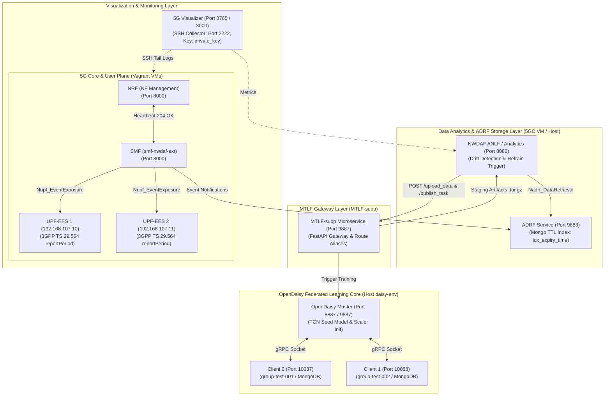

# 5G NWDAF & OpenDaisy 聯邦學習系統架構與運轉流程設計文件

## 一、 系統架構概覽 (System Architecture Overview)

本系統實現了符合 **3GPP 規範** 的 5G **NWDAF (Network Data Analytics Function)** 數據分析架構，結合 **ADRF (Analytics Data Repository Function)** 歷史數據儲存庫、**MTLF-subp** 通用 Gateway 微服務，以及 **OpenDaisy 聯邦學習 (Federated Learning, FL) 訓練核心**。

整個系統橫跨 **5G Core 控制面**、**UPF 用戶面**、**數據分析層**、**解耦訓練網關** 與 **聯邦學習訓練陣列**。



---

## 二、 核心元件職責與規格對齊 (Component Specifications)

### 1. UPF Event Exposure Service (`go-upf-ess`)
- **規範對齊**：3GPP TS 29.564 `Nupf_EventExposure` API。
- **欄位標準化**：統一採用 `reportPeriod` (標準駝峰 Tag) 傳遞週期秒數 (`PeriodSec > 0`)。
- **部署位置**：`UPF-EES` (`192.168.107.10`) 與 `UPF-EES2` (`192.168.107.11`) 虛擬機。
- **職責**：針對 UPF 內部的 GTP-U 數據封包量進行 URR (Usage Reporting Rule) 統計，並定期向 SMF 暴露 Event Notification。

### 2. SMF 擴充模組 (`smf-nwdaf-ext`)
- **檔案位址**：[`/home/king25158986/5G_Infrastructure/5GC/smf-nwdaf-ext`](file:///home/king25158986/5G_Infrastructure/5GC/smf-nwdaf-ext)
- **職責**：向 UPF-EES 發起 HTTP POST 訂閱 (`POST /nupf-ee/v1/ee-subscriptions`)，並精確帶入 `reportPeriod`。收到流量回報後轉換發送給 NWDAF/ADRF。

### 3. NRF (NF Management)
- **檔案位址**：[`/home/king25158986/free5gc/NFs/nrf`](file:///home/king25158986/free5gc/NFs/nrf)
- **職責**：維護 5GC 網元心跳 (`PATCH /nnrf-nfm/v1/nf-instances/`)，回覆 `204 No Content`，保證信令穩定性。

### 4. ADRF (Analytics Data Repository Function)
- **埠號**：`9888`
- **資料庫**：MongoDB `adrf` (`data_store_records` collection)
- **TTL 自動過期機制**：建立有 `idx_expiry_time` (`expiryTime`) 與 `idx_ingested_at` (`ingestedAt`) 索引。當資料到達 `expiryTime` 時，MongoDB 背景任務與 ADRF 清掃服務自動抹除舊紀錄，防止硬碟膨脹。

### 5. MTLF-subp 微服務網關 (MTLF Gateway)
- **檔案位址**：[`/home/king25158986/MTLF-subp`](file:///home/king25158986/MTLF-subp) 與 [`/datadisk/5G_Infrastructure/MTLF-subp`](file:///datadisk/5G_Infrastructure/MTLF-subp)
- **埠號**：`9887` (執行指令：`bash run.sh` 帶有 `--reload` 參數)
- **相容性路由**：
  - `POST /upload_data` & `POST /upload_data/` (OpenDaisy 原始上傳 API)
  - `POST /upload-data` & `POST /upload-data/` (FastAPI 標準別名)
  - `POST /publish_task` & `POST /publish_task/` (任務發佈 API)
- **職責**：作為解耦中繼，接收 Go NWDAF 發出的上傳與訓練請求，轉換數據適配器 (`ADRFDataToOpenDaisyAdapter`) 並下發至 OpenDaisy 訓練核心。

### 6. OpenDaisy 聯邦學習訓練核心 (Host FL Core)
- **執行環境**：`/home/king25158986/daisy-env` (Python 3.8.10)
- **檔案位址**：[`/home/king25158986/OpenDaisy/examples/07_MTLF_training`](file:///home/king25158986/OpenDaisy/examples/07_MTLF_training)
- **Master 伺服器 (PID 218072)**：監聽 API Port `9887` 與 FL Socket Port `8887`。負責根據 `MODEL_META` 動態建構 TCN (Temporal Convolutional Network) 種子模型，並執行 FedAvg 權重聚合與 EarlyStopping 評估。
- **Client 0 (PID 224972)**：綁定 `group-test-001`，透過 gRPC (`10087` -> `8887`) 連上 Master。直接從 MongoDB `daisy_mtlf.training_data` 讀取歷史數據進行本地 Epoch 運算。
- **Client 1 (PID 224973)**：綁定 `group-test-002`，透過 gRPC (`10088` -> `8887`) 連上 Master，讀取 MongoDB 資料運算。

### 7. 5G Visualizer 監控系統
- **檔案位址**：[`/datadisk/5G_Infrastructure/Visualizer/5g-viz`](file:///datadisk/5G_Infrastructure/Visualizer/5g-viz)
- **SSH 收集器配置**：配置於 `.env` 與 `profiles/default/.env`：
  - `SSH_5GC_PORT=2222`
  - `SSH_5GC_KEY=/datadisk/5G_Infrastructure/5GC/.vagrant/machines/default/virtualbox/private_key`
- **職責**：自動清除過期 `known_hosts` 指紋，透過 SSH 即時 Tail 虛擬機內的 `free5gc.log` 與 NWDAF 指標，呈現於 WebSocket (Port `8765`) 與 Grafana (Port `3000`)。

---

## 三、 整體運轉流程 (End-to-End Operational Workflow)

整個系統的動態運轉流程分為以下 5 個階段：

```mermaid
sequenceDiagram
    autonumber
    participant UPF as UPF-EES (10.10 / 10.11)
    participant SMF as SMF (5GC)
    participant ADRF as ADRF (Port 9888)
    participant NWDAF as NWDAF (Port 8080)
    participant MTLF as MTLF-subp (Port 9887)
    participant Daisy as OpenDaisy Master (Host)
    participant Clients as FL Client 0 & 1

    rect rgb(240, 248, 255)
        note over UPF, SMF: 階段 1: 流量監測與事件暴露 (Event Exposure)
        SMF->>UPF: 1. POST /nupf-ee/v1/ee-subscriptions (reportPeriod=5)
        UPF-->>SMF: 2. HTTP 201 Created (subscriptionId=sub-xxxx)
        UPF->>SMF: 3. 定期發送 Usage Report (PERIODIC, URR ID=1,2)
    end

    rect rgb(255, 248, 220)
        note over SMF, ADRF: 階段 2: 數據持久化與歷史查詢 (ADRF Storage)
        SMF->>ADRF: 4. POST /data-store-records (寫入 5G 流量數據)
        ADRF->>ADRF: 5. 存入 Mongo adrf.data_store_records (標記 expiryTime)
        ADRF->>ADRF: 6. 背景每 60 秒依 expiryTime 索引清理過期紀錄
    end

    rect rgb(240, 255, 240)
        note over NWDAF, MTLF: 階段 3: 自動重訓觸發與數據轉發 (Retrain Trigger)
        NWDAF->>NWDAF: 7. ANLF 檢測模型漂移 (Drift Detection / sMAPE Threshold)
        NWDAF->>ADRF: 8. GET /data-retrieval-subscriptions (撈取歷史視窗數據)
        NWDAF->>MTLF: 9. POST /upload_data (轉發歷史數據與 TID, group_id)
        MTLF->>MTLF: 10. ADRFDataToOpenDaisyAdapter 轉換格式並存入 daisy_mtlf
    end

    rect rgb(255, 240, 245)
        note over MTLF, Clients: 階段 4: 聯邦學習與多輪收斂 (Federated Learning)
        NWDAF->>MTLF: 11. POST /publish_task (帶入 ANLF Webhook Callback URL)
        MTLF->>Daisy: 12. 觸發 OpenDaisy Master (Port 8887) 建立 TCN 任務
        Daisy<-->>Clients: 13. Client 0 (10087) & Client 1 (10088) gRPC 連線
        Clients->>Clients: 14. 從 Mongo 載入 321,071 筆資料進行 Local Epoch 訓練
        Clients->>Daisy: 15. 回傳 Local 權重 (ClientUploadingSignal)
        Daisy->>Daisy: 16. 執行 FedAvg 權重聚合與 EarlyStopping 評估
    end

    rect rgb(245, 245, 255)
        note over Daisy, NWDAF: 階段 5: 自動封裝、Webhook 回傳與熱部署 (Hot Deploy)
        Daisy->>MTLF: 17. 訓練收斂完成 (EarlyStopping / Target Epoch Reached)
        MTLF->>MTLF: 18. 打包 model.npy 與 scaler.pkl 至 ./staging/tar.gz
        MTLF->>NWDAF: 19. POST ANLF Webhook Callback (通知 staging_model_url)
        NWDAF->>MTLF: 20. HTTP GET 下載最新模型套件
        NWDAF->>NWDAF: 21. 自動加載新權重至 ML-Service (Port 9090)，完成 Hot Deploy！
    end
```

---

## 四、 運轉驗證指令集 (Operational Verification Toolkit)

在維護與營運本系統時，可使用以下指令快速確認各層運轉狀態：

### 1. 檢查 UPF EES 訂閱與單元測試
```bash
cd /datadisk/5G_Infrastructure/go-upf-ess/go-upf
go test ./internal/ees/... -v
```

### 2. 檢查 MTLF-subp 微服務健康度與路由
```bash
curl -i http://127.0.0.1:9887/health
curl -i -X POST http://127.0.0.1:9887/upload_data -H 'Content-Type: application/json' -d '{"TID":"test","group_id":"group1","upfEventNotifs":[]}'
```

### 3. 檢查 Host 上 OpenDaisy 進程與 FL Clients 狀態
```bash
ps aux | grep -iE 'master\.py|client\.py'
```

### 4. 監控 OpenDaisy 訓練進度與 FedAvg 評估
```bash
tail -f /home/king25158986/OpenDaisy/examples/07_MTLF_training/master.log
tail -f /home/king25158986/OpenDaisy/examples/07_MTLF_training/client0.log
```

### 5. 檢驗 ADRF 數據筆數與 TTL 過期索引
```bash
/home/king25158986/daisy-env/bin/python3 -c "
import pymongo
client = pymongo.MongoClient('mongodb://127.0.0.1:27017')
print('ADRF 總紀錄數:', client['adrf']['data_store_records'].count_documents({}))
print('ADRF TTL 索引:', client['adrf']['data_store_records'].index_information().get('idx_expiry_time'))
"
```

---
*文件更新時間：2026-07-27*
*版本：v1.0 (End-to-End Verified)*
