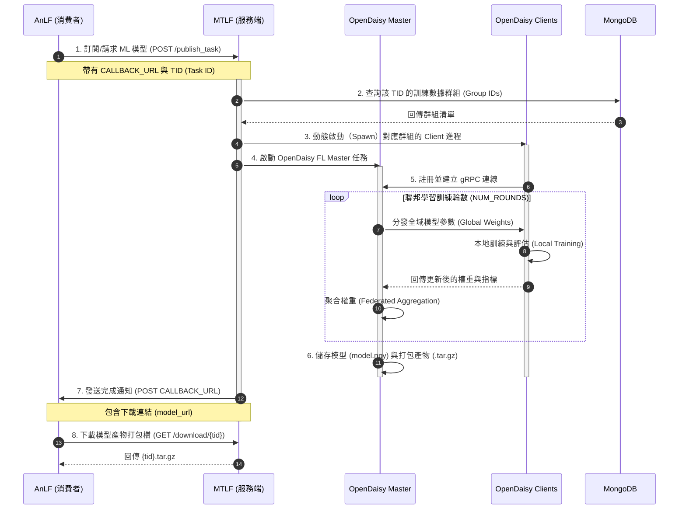

# AnLF 與 MTLF 及 OpenDaisy 互動溝通流程圖

本文件以 Mermaid 序列圖呈現 AnLF (Analytics Logical Function) 訂閱/請求 ML 模型、MTLF (Model Training Logical Function) 動態管理以及 OpenDaisy 執行聯邦學習 (FL) 訓練的完整互動流程。

---

## 1. 互動溝通流程圖

---

## 2. 各步驟詳細說明

1. **訂閱/請求模型**：AnLF 向 MTLF 暴露的 API 端點 `/publish_task` 發起 POST 請求，指定 `TID` 及 `CALLBACK_URL`。此行為對照 3GPP 的 `Nnwdaf_MLModelProvision_Subscribe`，實作於 [server_api_handler.py:publish_task](file:///home/king25158986/OpenDaisy/src/py/daisyfl/master/server_api_handler.py#L115)。
2. **查詢數據群組**：MTLF 會與 MongoDB 連線，根據任務 `TID` 查找有哪些屬於該任務的資料組別 (`group_id`），做為動態啟動對應聯邦學習客戶端（Clients）的依據。
3. **動態啟動客戶端**：MTLF 利用子進程（`subprocess`）動態執行 [client.py](file:///home/king25158986/OpenDaisy/examples/07_MTLF_training/client.py)，並帶入對應的 `group_id`。
4. **啟動 Master 任務**：MTLF 主進程內部會呼叫 `_task_manager.receive_task` 進入 OpenDaisy 聯邦學習的主控端流程，實作於 [app.py:start_master](file:///home/king25158986/OpenDaisy/src/py/daisyfl/master/app.py#L60)。
5. **gRPC 註冊連線**：各 Client 進程啟動後，使用 gRPC 向 Master 伺服器註冊。
6. **聯邦學習疊代**：Master 與 Clients 進行多輪的模型參數分發、本地資料集訓練、權重更新上報以及伺服器端參數聚合（例如 `FedAvg`）。
7. **儲存與打包**：訓練結束後，Master 彙整最終權重，儲存為 `model.npy` 並將模型、Scaler (.pkl) 與後設配置（`config.json`）包裝成 `tar.gz` 壓縮檔保存於 `artifacts/` 目錄下。
8. **發送完成通知**：MTLF 向 AnLF 所提供的 `CALLBACK_URL` 發送 POST 通知，附帶下載位址。
9. **模型檢索/下載**：AnLF 使用該 URL 呼叫 MTLF 的 `/download/{tid}` 下載打包後的最終模型產物。
