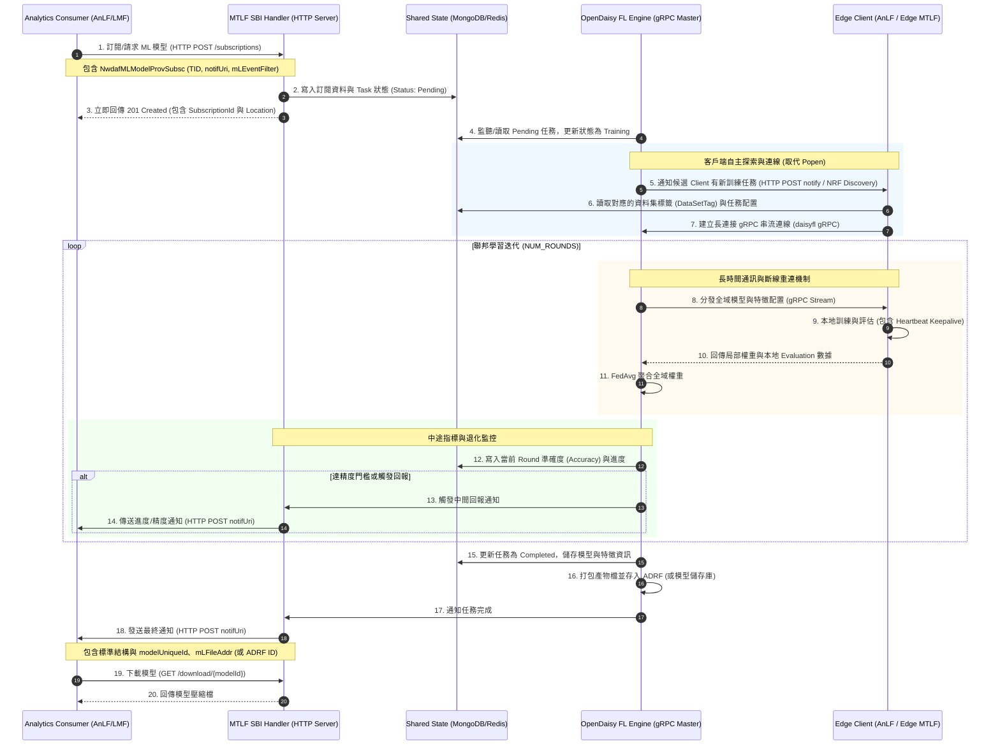

# OpenDaisy 與 3GPP 理想互動溝通設計文檔 (長時間通訊與 gRPC 機制)

本文件針對 OpenDaisy 的技術特性（包括**長時間的聯邦學習訓練**、**gRPC 長連接管理**、**異地節點斷線重連**）與 3GPP NWDAF 規範要求，設計了「理想中」符合生產環境標準的 MTLF 與 AnLF 互動溝通流程。

---

## 1. 現有實作的局限性與設計挑戰

在現有範例 [07_MTLF_training](file:///home/king25158986/OpenDaisy/examples/07_MTLF_training/) 中：
1. **控制面與數據面耦合**：接收到 `/publish_task` HTTP 請求後，Master 與 gRPC 服務在同一個進程/執行緒中直接拉起，且透過 Python 的 `subprocess.Popen` 在本地硬編碼拉起 Client 子進程。這在分佈式 5G 核心網環境下無法運作。
2. **缺乏即時進度監控**：聯邦學習通常需要執行數小時甚至數天，現有機制僅在訓練完全結束時才透過 `CALLBACK_URL` 通知一次，AnLF 無法在中途得知訓練進度（如當前 Round）或中途的模型精度與退化狀況。
3. **沒有長連接斷線容錯**：沒有完善的 gRPC Keepalive 與 Client 隨機斷線重連/動態加入機制。

---

## 2. 理想互動架構設計圖

理想架構應將 **HTTP SBI 控制面 (Control Plane)** 與 **gRPC 數據面 (Data Plane)** 完全解耦，並引入**共享狀態資料庫 (如 MongoDB/Redis)** 進行非同步任務管理。

---

## 3. 技術設計細節說明

### 3.1 HTTP SBI 控制面與 gRPC 數據面解耦
* **SBI Handler (HTTP 伺服器)**：僅負責處理 RESTful 請求。當接收到訂閱後，將配置格式化存入資料庫，並立即回傳 `201 Created`（在 Response Header 的 `Location` 攜帶訂閱資源的 URI，例如 `/subscriptions/sub123`）。這確保了 AnLF 不會因為聯邦學習訓練時間過長而導致 HTTP 連線 Timeout。
* **FL Engine (gRPC Master 服務)**：為獨立運作的微服務，常駐於背景，透過資料庫隊列（Queue）或事件機制（如 Redis Pub/Sub）接收新任務，並負責開啟 gRPC 連接埠等待 Clients。

### 3.2 節點自主探索與動態連線 (取代 Popen)
* 在標準的 5G 網絡中，MTLF 不應直接以 `subprocess` 啟動 Client。
* **探索機制**：MTLF 會向指定的邊緣節點（例如各區域的 AnLF）發送訓練邀請通知（Notification），或由 Client 節點週期性透過 NRF (Network Repository Function) 探索是否有可參與的訓練任務。
* **DataSetTag 對接**：Client 節點在得知 `TID` 後，會自主向其本地的 ADRF 或本地資料庫提取對應的 `DataSetTag` 資料，然後發起 gRPC 連線加入聯邦學習。

### 3.3 長時間通訊容錯與狀態監控機制
* **gRPC Keepalive (心跳包)**：由於 FL 迭代耗時較長，Master 與 Client 之間需開啟 gRPC Keepalive 機制，設定合理的心跳檢測間隔（例如 30 秒），防止防火牆或中間代理網絡因連線閒置而強制中斷 Socket。
* **動態 Client 替換 (Dynamic Aggregation)**：
  - 開發自訂策略（擴展自 [custom_strategy.py](file:///home/king25158986/OpenDaisy/examples/07_MTLF_training/custom_strategy.py)），當某個 Client 因故障中斷連線時，Master 不會卡死，而是根據設定（例如：只要有超過 70% 的註冊 Client 回報即可進行聚合）繼續訓練，或是在下一輪迭代中允許 Client 斷線重連後重新加入。

### 3.4 訓練進度與退化監控 (TS 23.288 6.2E)
* **中途監控**：在聯邦學習迭代期間，Master 將每一輪聚合後的全域模型精度、當前 Round 以及 Loss 寫入共享資料庫。
* **主動通知 (Notify)**：若 AnLF 在訂閱時設定了 `mLModelAccuracyThreshold`，當 Master 評估出全域精度低於/高於門檻，或達到指定的彙報間隔時，MTLF 會主動向 AnLF 的 `notifUri` 發送 POST 通知，回報當前的模型狀態。這能讓 AnLF 即時得知訓練狀態，甚至在模型精度達標時提前發起中斷或提取模型。
