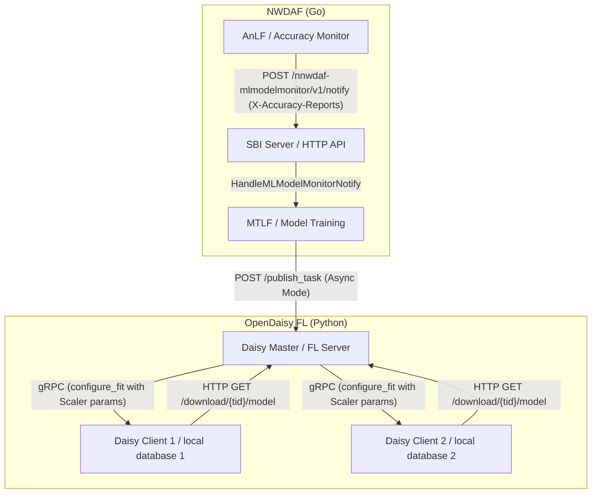

# NWDAF SBI and OpenDaisy FL Compliance Integration Design Document

This document outlines the architecture, design specifications, and implementation details for exposing standard 3GPP Service-Based Interfaces (SBI) in the NWDAF component and modifying the OpenDaisy Federated Learning (FL) training architecture to be fully compliant with decentralized privacy principles.

---

## 1. Architectural Overview & 3GPP Compliance

According to **3GPP TS 23.288** and **TS 29.520**, interactions between the NWDAF AnLF (Analytics Logical Function) and MTLF (Model Training Logical Function) should proceed via standard Service-Based Interfaces (SBI) rather than direct in-memory callbacks. Furthermore, in Federated Learning deployments, clients must operate under strict network bounds without shared disk access or centralized database bypasses.

---

## 2. Standard SBI API Design (NWDAF Go)

We registered and implemented standard routes for two 3GPP services: `Nnwdaf_MLModelProvision` and `Nnwdaf_MLModelMonitor`.

### 2.1 Service Routes
The following routes are registered in the SBI HTTP server group `/nnwdaf-mlmodelprovision/v1` and `/nnwdaf-mlmodelmonitor/v1`:
- `POST /nnwdaf-mlmodelprovision/v1/subscriptions` (Subscribe to model provisions)
- `DELETE /nnwdaf-mlmodelprovision/v1/subscriptions/:subscriptionId` (Unsubscribe)
- `POST /nnwdaf-mlmodelmonitor/v1/registrations` (Register model monitoring)
- `DELETE /nnwdaf-mlmodelmonitor/v1/registrations/:registrationId` (Deregister monitoring)
- `POST /nnwdaf-mlmodelmonitor/v1/subscriptions` (Create monitoring subscription)
- `DELETE /nnwdaf-mlmodelmonitor/v1/subscriptions/:subscriptionId` (Delete monitoring subscription)
- `POST /nnwdaf-mlmodelmonitor/v1/notify` (Receive model accuracy alerts)

### 2.2 Model & Context Mapping
We introduced standard structures representing 3GPP schemas inside `sbi_models.go`:
- `NwdafMLModelProvSubsc`: ML Model Provision subscription request.
- `NwdafMLModelProvNotif`: Callback notification containing updated model file address.
- `MLModelMonitorReg`: Registrations for model accuracy monitoring.
- `MLModelMonitorSub` / `MLModelMonitorNotify`: Subscriptions and loopback notifications for accuracy reports.
- `EventFilter`: Declared locally as a placeholder to allow standard compilation without external schema conflicts.

A thread-safe bidirectional map (`modelIdToUrlMap` / `modelUrlToIdMap`) was added to `NWDAFContext` to translate between unique `uint32` model IDs and internal `string` model URLs.

### 2.3 Accuracy Monitoring & Alerting Flow
1. **AnLF side**: When evaluating predictions, the accuracy monitor produces raw metric reports. Instead of an in-memory trigger, it serializes these reports into JSON and sends an HTTP POST request to `/nnwdaf-mlmodelmonitor/v1/notify`, passing the reports via the custom `X-Accuracy-Reports` header.
2. **MTLF side**: The notify handler (`HandleMLModelMonitorNotify`) retrieves the HTTP request, parses `X-Accuracy-Reports`, and delegates the metric checking to the MTLF's evaluation policies (`HandleAccuracyReports`), which trigger retraining if z-score deviation or chronic thresholds are breached.

---

## 3. Federated Learning Compliance Design (OpenDaisy Python)

To enable multi-node deployments and preserve data privacy boundaries, the following adjustments were made to the OpenDaisy training codebase:

### 3.1 Network-based Scaler Propagation (No Shared Disk)
- **Problem**: Previously, `custom_strategy.py` saved `scaler.pkl` to the local disk, and the client directly read it from that path. This bypass fails in distributed multi-node settings.
- **Design**:
  - **Server (Strategy) side**: `EarlyStoppingFedAvg.aggregate_fit` calculates the global statistics (`mean` and `var`) and stores them on the strategy instance. In `configure_fit`, these statistics are injected into the standard `config` payload dictionary for the next round.
  - **Client side**: `DaisyTrainer.fit` receives the statistics from the `config` payload, reconstructs the `StandardScaler` object in-memory, and passes it to `reload_dataloaders()`.

### 3.2 Database Connection Isolation
- **Problem**: Client nodes query a single centralized MongoDB instance, violating the FL principle that data must remain local.
- **Design**:
  - Modified `load_tid_documents` in `dataset.py` to read connection and database configurations dynamically using group-specific configuration keys (e.g. `MONGO_URI_{group_id}` and `MONGO_DB_{group_id}`).
  - Enforced query boundaries by filtering strictly on `group_id` to prevent cross-client data leakage.

### 3.3 Dynamic Model Distribution
- Exposed `/download/<tid>/model` and `/download/<tid>/scaler` endpoints in `server_api_handler.py` to allow client nodes to pull the required artifacts dynamically over HTTP GET instead of local filesystem copy.

---

## 4. File-by-File Changes Summary

### 4.1 Go NWDAF Component
- [internal/context/sbi_models.go](file:///home/king25158986/5G_Infrastructure/NWDAF/NWDAF/internal/context/sbi_models.go): Added standard 3GPP struct types and a local `EventFilter` placeholder.
- [internal/context/context.go](file:///home/king25158986/5G_Infrastructure/NWDAF/NWDAF/internal/context/context.go): Extended `NWDAFContext` with map structures and thread-safe mapping helper functions.
- [internal/sbi/server.go](file:///home/king25158986/5G_Infrastructure/NWDAF/NWDAF/internal/sbi/server.go): Registered route groups for provision and monitor services.
- [internal/sbi/api_mlmodelprovision.go](file:///home/king25158986/5G_Infrastructure/NWDAF/NWDAF/internal/sbi/api_mlmodelprovision.go): Implemented provision subscription handlers.
- [internal/sbi/api_mlmodelmonitor.go](file:///home/king25158986/5G_Infrastructure/NWDAF/NWDAF/internal/sbi/api_mlmodelmonitor.go): Implemented monitor registration, subscription, and notification handlers (delegates report evaluation to MTLF).
- [internal/sbi/processor/processor.go](file:///home/king25158986/5G_Infrastructure/NWDAF/NWDAF/internal/sbi/processor/processor.go): Customized accuracy report hook to serialize metrics and send HTTP notify requests.
- [internal/mtlf/training.go](file:///home/king25158986/5G_Infrastructure/NWDAF/NWDAF/internal/mtlf/training.go): Added a safety context check to prevent nil pointer dereferences during unit test runs.

### 4.2 Python OpenDaisy Component
- [OpenDaisy/examples/07_MTLF_training/custom_strategy.py](file:///home/king25158986/OpenDaisy/examples/07_MTLF_training/custom_strategy.py): Modified strategy to capture and transmit global scaler parameters via configuration.
- [OpenDaisy/examples/07_MTLF_training/client.py](file:///home/king25158986/OpenDaisy/examples/07_MTLF_training/client.py): Reconstructed the scaler dynamically in-memory and applied it during dataloader reloads.
- [OpenDaisy/examples/07_MTLF_training/dataset.py](file:///home/king25158986/OpenDaisy/examples/07_MTLF_training/dataset.py): Extended `get_dataloaders` signature and enforced group-based database query boundaries.
- [OpenDaisy/src/py/daisyfl/master/server_api_handler.py](file:///home/king25158986/OpenDaisy/src/py/daisyfl/master/server_api_handler.py): Implemented `/download/<tid>/model` and `/download/<tid>/scaler` HTTP GET routes.

---

## 5. Verification Results

All tests compiled successfully:
- **Go Tests**: All unit tests in the package passing (`go test ./...` completed successfully).
- **Python Syntax**: Verified that `client.py`, `custom_strategy.py`, `dataset.py`, and `server_api_handler.py` compile successfully with no syntax errors.
